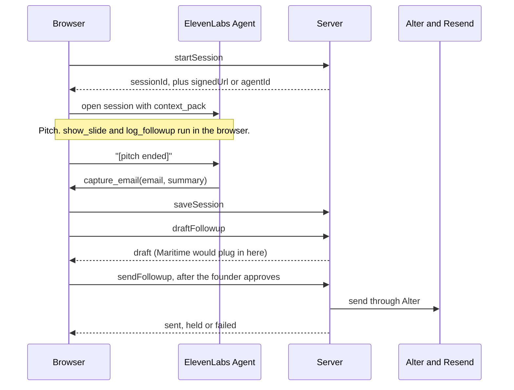

# evee: server protocol and where Maritime plugs in

For the backend and Maritime owner. Written against the code on `main` at commit `8d5708e`. If the code and this file disagree, the code wins.

## The short version

- During the pitch the server is not involved. ElevenLabs and the browser handle every question.
- The server has four actions, each a `POST /api/<name>` with a JSON body (`server/index.js`).
- The follow-up email is a fixed template today (`buildDraft` in `src/server/followup.js`). No AI runs on the server.
- Maritime is not wired in yet. Its plug point is the draft step. Two catches are listed below.



## The four actions

| Action | Body | Returns |
|---|---|---|
| `startSession` | `{}` | `{ sessionId, signedUrl }` when `ELEVENLABS_API_KEY` is set, otherwise `{ sessionId, agentId }` |
| `saveSession` | `{ sessionId?, transcript?, slides?, openQuestions?, email?, summary? }` | `{ sessionId }`. Creates the row if there is no id |
| `draftFollowup` | `{ sessionId }` | `{ to, subject, text, questions, slides, openQuestions, summary, status }` |
| `sendFollowup` | `{ sessionId, email? }` | `{ status, dryRun?, approvalUrl?, error? }` where status is `sent`, `held` or `failed` |

Without Alter keys, `sendFollowup` logs a dry run and reports `sent`.

## The session: what Maritime would get

One row per pitch (`schema.prisma`).

```ts
type Session = {
  id: string;
  startedAt: string;
  transcript: { role: string; text: string; at: string }[];
  slides: {
    id: string;              // "s1", "s2", ...
    at: string;
    trigger: string;         // the question or topic that caused the slide
    title: string;
    bullets: string[];       // up to 3
    stat: { value: string; label: string } | null;
    imageId: string | null;
    sourceIds: string[];     // ids of the upload chunks it was built from
  }[];
  openQuestions: { question: string; at: string }[];   // asked, not answered by the uploads
  email: string | null;      // one email per session
  summary: string;           // 2 to 3 sentences written by the voice agent at the end
  status: "draft" | "held" | "sent" | "failed";
};
```

Transcript rows with `role: "question"` are the questions evee reacted to. The other rows are what ElevenLabs heard and said.

Example to test with:

```json
{
  "id": "test-001",
  "startedAt": "2026-11-22T19:40:00Z",
  "transcript": [
    { "role": "question", "text": "How big is the market?", "at": "2026-11-22T19:40:41Z" },
    { "role": "question", "text": "Do you integrate with Salesforce?", "at": "2026-11-22T19:41:35Z" }
  ],
  "slides": [
    {
      "id": "s1",
      "at": "2026-11-22T19:40:41Z",
      "trigger": "How big is the market?",
      "title": "US trade show market",
      "bullets": ["24–32% of B2B marketing budget goes to events"],
      "stat": { "value": "$16–24B", "label": "a year" },
      "imageId": null,
      "sourceIds": ["c4"]
    }
  ],
  "openQuestions": [
    { "question": "Do you integrate with Salesforce?", "at": "2026-11-22T19:41:35Z" }
  ],
  "email": "judge@example.com",
  "summary": "The visitor asked about market size and CRM integrations. The Salesforce question is still open.",
  "status": "draft"
}
```

## Where Maritime plugs in

The plug point is `draftFollowup` in `src/server/followup.js`: send the session to a Maritime agent, get back the email text, and fall back to the current template if Maritime errors or is slow, so the demo never blocks.

```
POST https://api.maritime.sh/api/agents/{agent_id}/chat
Authorization: Bearer <maritime key>
{ "message": "<instructions + the session as JSON>" }
→ { "response": "..." }
```

The call waits for the agent's full reply, and a sleeping agent takes about a second to wake. Ask it for JSON only (`{"subject": "...", "text": "..."}`) and parse leniently.

Catches in the current code:

| Catch | Why it matters | Fix |
|---|---|---|
| `sendFollowup` calls `buildDraft` again at send time | The email that goes out would be the template, not the Maritime text the founder approved | Save the Maritime text on the Session (new column) and have `buildDraft` use it when present |
| `draftFollowup` is called twice | The follow-up screen drafts on entry and again when the agent's summary arrives. Two Maritime calls, each taking seconds | Cache the draft per session, or only call Maritime once the summary is in |
| The server never sees the uploads | The context pack lives in browser memory; `saveSession` does not send it. Maritime cannot answer open questions from the deck | Add the pack text to `saveSession` if Maritime should answer open questions |

Suggested new env vars in `.env.server` and `.env.server.example`: `MARITIME_API_KEY`, `MARITIME_AGENT_ID`.

What Maritime can add over the template:

| Idea | Needs |
|---|---|
| A properly written email instead of bullet lists | Nothing new |
| Answers to the open questions | The context pack on the server (third catch) |
| A line about the visitor's company | A lookup from the email domain (Fiber AI) |

## One pitcher, several visitors

| | Today |
|---|---|
| Any visitor asks a question | Works. The slide answers it, whoever asked |
| Emails | One per session |
| Who asked which question | Not known. The agent hears one mixed audio stream |
| Which voice is the pitcher | Not known. The agent reacts to questions and topic changes from anyone |

ElevenLabs can label speakers, but only in its realtime transcription API (`diarize=true`, model `scribe_v3_live`), not inside the live agent. The labels are anonymous (`speaker_0`, `speaker_1`), can be revised as more audio arrives, and cannot be combined with background-noise filtering. With a labelled transcript, the pitcher is the speaker with the most words, and Maritime could match questions to visitors for per-person follow-ups. Not planned for today.

## Keys

All keys live in `.env.server` and never reach the browser. See `.env.server.example`.

## Open items before the demo

- Placeholder copy is still in the code: `[email subject]` and `[email intro]` in `src/server/followup.js`, and `[email request line]` in `agent/prompt.md`.
- The ElevenLabs agent has to be created in the dashboard from `agent/prompt.md` and `agent/tools.json`, and its id put in `.env.server`.
