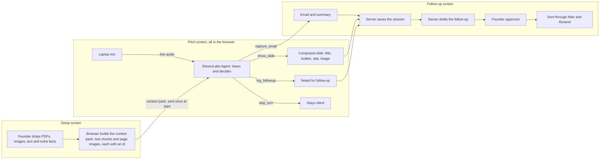
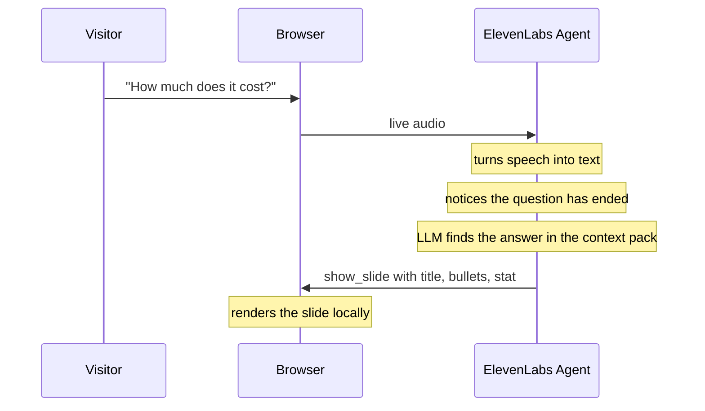
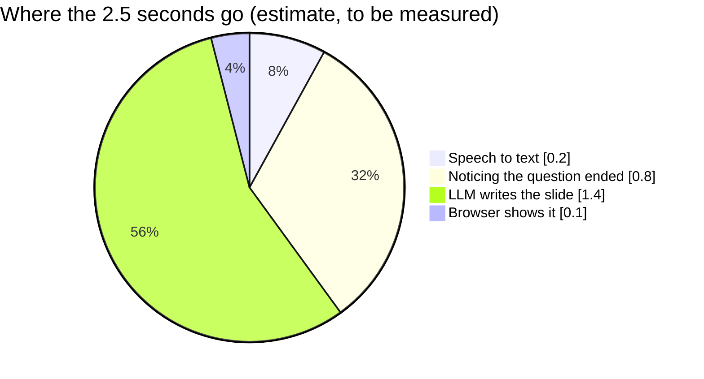
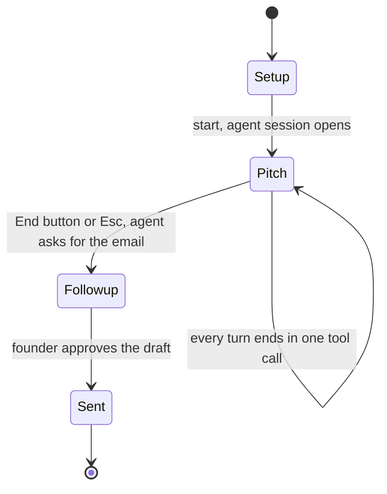

# evee: how it works

evee listens to a live pitch. When someone asks a question or the talk moves to a new topic, it composes a slide from the founder's own uploads and shows it within a few seconds. Afterwards it collects the visitor's email and drafts a follow-up from what was asked.

## The whole system

## One question, start to finish

Target is under 5 seconds. The server is not in this path.

## What evee does with what it hears

| What is said | Example | evee does | Tool |
|---|---|---|---|
| A question the uploads answer | "How big is the market?" | Shows a slide with the answer | `show_slide` |
| A clear move to a new topic | "Let's talk about pricing." | Shows a slide for that topic | `show_slide` |
| A question the uploads do not answer | "Do you integrate with Salesforce?" | Shows "Noted for follow-up", logs it | `log_followup` |
| Small talk, half sentences, more on the same topic | "Nice booth!" | Nothing | `skip_turn` |
| The same slide again within 6 seconds | | Ignored by the browser | none |
| Founder ends the pitch (End button or Esc) | | evee speaks, asks for the email, spells it back | `capture_email` |

## Screens

## Where things live

| Piece | Where |
|---|---|
| Agent prompt and tool schemas | `agent/prompt.md`, `agent/tools.json`, pasted into the ElevenLabs dashboard |
| Agent session and client tools | `src/client/lib/agent.js` |
| Context pack from uploads | `src/client/lib/context.js` |
| Screens | `src/client/screens/` |
| Session and follow-up actions | `src/server/session.js`, `src/server/followup.js` |
| Server protocol and the Maritime plug point | `PROTOCOL.md` |

## Partner tools

| Tool | When | Job | State |
|---|---|---|---|
| ElevenLabs Agents | Live | Listens, composes slides, asks for the email | Code done; agent to be created in the dashboard |
| Alter | After | Holds the follow-up send for approval | Code done; dry run without keys |
| Resend | After | Delivers the email, called through Alter | Code done |
| Maritime | After | Would write the follow-up | Not wired; see `PROTOCOL.md` |

## To the deadline

```mermaid
gantt
  title Remaining work to 3:00
  dateFormat HH:mm
  axisFormat %H:%M
  section Voice
  Create agent in dashboard     :a1, 12:40, 20m
  Test on sample and real deck  :a2, after a1, 30m
  Tune prompt                   :a3, after a2, 30m
  section Ship
  Feature freeze                :milestone, m1, 14:15, 0m
  Record video                  :v1, 14:30, 15m
  Submit                        :milestone, m2, 14:45, 0m
  Hard deadline                 :crit, milestone, m3, 15:00, 0m
```

